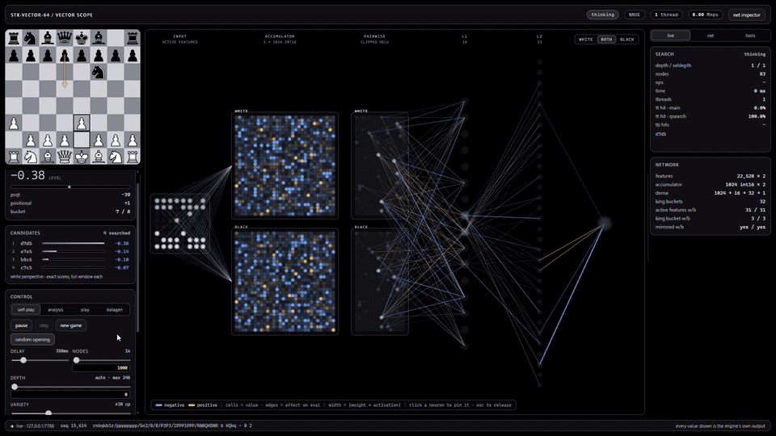

# STK-Vector-64

A C++20 chess engine with UCI search, an integer STK-HalfKA neural evaluator,
crazyhouse and bughouse board support, and Vector Scope for inspecting the
network while the engine plays.

[Releases](https://github.com/fcmv/Vector-64/releases) ·
[Documentation](docs/index.md) · [Contributing](CONTRIBUTING.md) ·
[Known limitations](LIMITATIONS.md)

[](docs/assets/it-thinks-v1.1.0-platforms.mp4)

The colors and connections update as the sampled position changes. The trained
weights stay fixed. This is a view of neural inference, not every search node
or an explanation of the complete move decision.
[Capture notes](docs/media.md)

The standard engine uses bitboards, legal move generation, iterative-deepening
alpha-beta search, a transposition table, and optional Syzygy tablebases.
The shipped network has 22,528 features per perspective and a 1024-wide
accumulator. Its architecture and binary contract are documented in
[STK-HalfKA](docs/vector64-spec.md). Drop variants use classical evaluation.

## Choose a binary

Each release asset starts with its platform and CPU profile. The suffix selects
the engine's capabilities; `.exe` is last on Windows.

| Binary / suffix | Use |
|---|---|
| `ChessEngine` / no suffix | Standard chess with classical evaluation; can load a network with `EvalFile`. |
| `ChessEngine-nnue` / `-nnue` | Standard chess with the default network embedded. Start here for ordinary chess. |
| `ChessEngine-all` / `-all` | Embedded NNUE for standard chess; classical evaluation for crazyhouse and bughouse. |
| `ChessEngine-variants` / `-variants` | Standard chess and drop variants, without an embedded network. |
| `ChessEngine-validator` / `-validator` | Legal moves, position updates, and status queries; search commands are refused. |
| `ChessEngine-viz` / `-viz` | Vector Scope: local browser UI, network telemetry, analysis, and self-play. |

Linux `x86-64-v3` needs the x86-64-v3 instruction set, including AVX2/BMI2;
`x86-64-v2` targets an older baseline. Windows release binaries require AVX2.
`arm64-dotprod` requires ARMv8.2 dot-product support; plain `arm64` is the
baseline ARM build. See [installation and first use](docs/getting-started.md).

## First UCI session

A UCI chess GUI launches the engine and owns the board and clocks. Add the
`-nnue` executable as a UCI engine in your GUI, or start it directly. It reads
commands from standard input and writes replies to standard output.

Enter `uci` and wait for `uciok`, then `isready` and wait for `readyok`.
Then enter:

```text
ucinewgame
position startpos moves e2e4 e7e5
go depth 6
```

Wait for `bestmove` before sending `quit`. The exact move and scores are not
part of this example's contract. [UCI reference](docs/uci.md) explains options,
time controls, and process lifetime. A runnable standard-library Python client
is in [examples/uci_client.py](examples/uci_client.py).

## Build from source

Commands throughout the documentation run from the repository root unless
stated otherwise. CMake 3.15 or newer and a C++20 compiler are required.

Linux with GCC or Clang:

```bash
cmake -S . -B build -DCMAKE_BUILD_TYPE=Release -DENGINE_NATIVE=OFF
cmake --build build -j
ctest --test-dir build --output-on-failure
./build/bin/ChessEngine-nnue
```

Windows, from a Visual Studio developer shell with C++ build tools installed:

```powershell
cmake -S . -B build
cmake --build build --config Release
ctest --test-dir build -C Release --output-on-failure
.\build\bin\Release\ChessEngine-nnue.exe
```

The default build includes the visualizer and fetches two hash-pinned headers
on first configure. Use `-DENGINE_VIZ=OFF` for an engine-only/offline build.
C++ builds embed the committed UI and do not require Node or Python.
[Building](docs/building.md) covers MSYS2, macOS, portable builds, and options.

## Check a position or inspect the network

```bash
./build/bin/ChessEngine --perft
./build/bin/ChessEngine-viz --headless
```

The visualizer serves its UI at `http://127.0.0.1:7777`. See
[Vector Scope](docs/visualizer.md) for native and WebAssembly use.
[Host integration](docs/engine-integration-response.md) covers worker lifecycle
and application responsibilities; [validator queries](docs/validator.md) use JSON.
The [variant guide](docs/variants.md) explains drops, reserves, and host responsibilities.

## Train the existing NNUE architecture

The PyTorch entry points share the STK-HalfKA model, feature encoder, exporter,
and integer oracle. Both implemented accumulator widths, 1024 and 128, use the
same contract. The fixed architecture baseline is the published v1.0.0 Windows
`-nnue.exe`; its embedded model matches the local shipped network byte for byte.
The [network contract](docs/vector64-spec.md) records that release identity.

Start with the [CPU training walkthrough](docs/nnue-training.md), which includes
a tiny dataset, export, and engine parity. Large datasets and Bullet training
have separate instructions. Older 81,920-feature HalfKP checkpoints cannot be
loaded into this engine.

## Development and scope

[Architecture](docs/architecture.md) is the subsystem map;
[engineering](docs/implementation/engineering.md) connects it to code and tests.
[Testing](docs/testing.md) and [BENCHMARK.md](BENCHMARK.md) distinguish correctness,
search fingerprints, performance, and playing strength.

The validator currently has a mating-material adjudication defect, and failed
network replacement is not transactional. Read [LIMITATIONS.md](LIMITATIONS.md)
before depending on those interfaces. Bughouse support is for one board with
host-supplied reserves; it is not a complete partner-coordination system.

This documentation describes the checkout. `--perft-divide` and the shared
training CLI are development changes relative to v1.0.0. Use documentation from
the corresponding tag when working with a released binary.

Questions and reproducible bugs go through [SUPPORT.md](SUPPORT.md).
Contributions follow [CONTRIBUTING.md](CONTRIBUTING.md). Compatibility boundaries
are in [STABILITY.md](STABILITY.md).
Review responsibilities and community standards are in [GOVERNANCE.md](GOVERNANCE.md)
and [CODE_OF_CONDUCT.md](CODE_OF_CONDUCT.md).

[ROADMAP.md](ROADMAP.md) records priorities, completion criteria and candidate
features within the released NNUE architecture.

[CHANGELOG.md](CHANGELOG.md) and [documentation versions](docs/versions.md)
identify release differences. The [datagen guide](docs/datagen.md) follows
self-play rows into the checked training pipeline.

## License

The repository root carries [Apache-2.0](LICENSE). The UI declares
GPL-3.0-or-later and includes Chessground; Fathom and other components retain
their own terms. [Third-party notices](THIRD_PARTY_NOTICES.md) describes these
boundaries. The embedded model's available provenance is recorded in its
[model card](nets/model-card.md).
