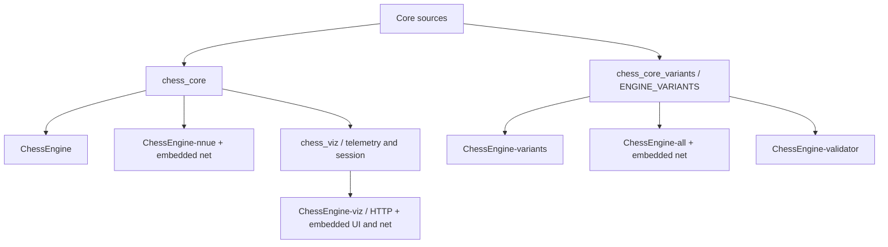
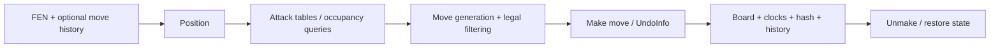

# Architecture

This page maps the current engine. The [engineering guide](implementation/engineering.md)
connects each boundary to its code and tests; the [engine contract](spec/engine-contract.md)
and [STK-HalfKA contract](vector64-spec.md) specify observable behavior.

The [repository layout](repository-layout.md) identifies build modules, packaged
tools, shared diagnostics and the vendored dependency boundary.

## Build boundaries

`chess_core` contains position/move generation, UCI, search, NNUE, native datagen,
and the Syzygy wrapper plus vendored Fathom. It has no HTTP or JSON dependency.
Variant sources compile a second time with `ENGINE_VARIANTS`, so standard
binaries keep their standard position layout and smaller move buffers.

`chess_viz` links the standard core. Its telemetry, session driver, HTTP server,
and UI are separate from tournament binaries. `ENGINE_VIZ=OFF` omits its
libraries, executables, downloaded headers, and tests.

## Position and move flow

Board state uses 64-bit bitboards and a mailbox. Moves are 16-bit values with
source, destination, and flags. The variant encoding reuses the source field
for a dropped piece type. Position updates maintain material, piece-square
score, Zobrist identity, and history incrementally. Special moves require
additional deltas: castling moves a rook, en passant removes a pawn off the
capture destination, and promotion changes the moving piece type.

Legal filtering uses attack/occupancy information rather than making every
candidate on a full board copy. King moves, pins, check evasion, and castling
need their corresponding occupancy context. Variant drops add blockers and
have separate legality and reserve handling.

## Search and ownership

The [search implementation guide](search.md) expands the algorithm, TT,
pruning guards, time limits and verification boundaries.

The UCI loop owns a resident position and an asynchronous search thread. A
search receives a root copy. `stop` joins that search and permits its final
`bestmove`; `quit` shuts it down. A worker process should serve one client
request sequence at a time.

Search uses iterative deepening, negamax alpha-beta, principal variations,
move ordering, transposition-table bounds, pruning/reductions, and quiescence.
The TT has four 16-byte entries per 64-byte bucket. Replacement considers
stored depth and generation. The static evaluation is cached with search
entries where applicable.

Lazy SMP helpers share the TT and read-only evaluator weights. Each helper
owns its own position, move-ordering state, accumulator stack, refresh tables,
and search counters. The master publishes search information. Scheduling and
wall-clock budgets make multi-threaded runs nondeterministic.

## Evaluation

The fixed current network is STK-HalfKA: 22,528 features per perspective,
H=1024 or H=128, pairwise clipped activations, eight dense output buckets, and
an integrated PSQT side output. Its integer score is relative to the mover.

The search maintains big-network accumulators incrementally and resolves
refresh barriers as needed. A loaded small net can answer at nodes where the
classical estimate exceeds `SmallNetThreshold`; `LazyEvalMargin` can skip the
network entirely for sufficiently large estimates. These are selection policies
around the existing architecture. The standalone `eval` command rebuilds an
accumulator and prefers the loaded big net, then small net, then classical eval.

Drop variants suppress NNUE without unloading it. Their classical evaluation
includes board material/PSQT, reserve material, and variant evaluation terms.
Returning to standard chess restores the loaded network. Syzygy uses external
standard-chess tables; root DTZ ranking is master-only. The current probing path
lacks a runtime-variant guard, so keep `SyzygyPath` empty for drop-variant search.
See the [tablebase limitations](limitations.md#tablebase-search).

## Training and visualization

Python preparation, training, quantization, and export share the feature encoder
and `STKNet`. Dataset labels are white-relative; the model output is mover-relative.
The integer Python oracle checks exported inference against the C++ engine.
Bullet trains floating-point weights and transfers them into the same exporter.

Vector Scope captures a separate forward pass outside search's hot path. The
session driver publishes snapshots; the binary wire encoder feeds HTTP and
WASM transports. React/TypeScript renders them without implementing engine
rules. WASM is linked by `tools/build_wasm.sh`, which explicitly lists its
telemetry/session sources; it does not reuse the native `chess_viz` target.

The [limitations](limitations.md) document states the current failure boundaries.
Neither this architecture map nor the consistency tests establish complete
rule adjudication or race freedom for every concurrent search interleaving.
