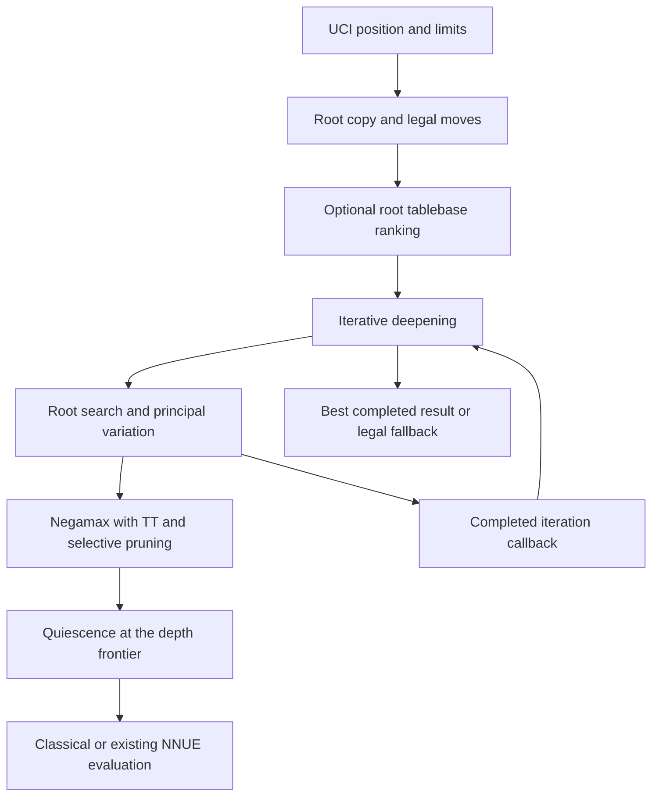

# Search implementation

This guide maps current search behavior to `src/search/search.cpp`,
`move_ordering.{h,cpp}`, `transposition_table.h` and `src/uci/uci.cpp`.
It explains the implementation rather than prescribing new heuristics or
changing the released NNUE architecture. Constants below are current code
choices, not a stable tuning API or evidence of their individual Elo value.

## One search

The master searches progressively deeper iterations. Single-PV uses a full
window initially, then an aspiration window around the preceding score from
depth 4. The initial margin is 25 cp; failure widens/repositions the window
and researches. A move that looks good under a narrow bound is not necessarily
an exact full-window score.

The shared search limit is 256 plies, including selective work. Nominal depth
is capped at 246 to reserve ten plies for extensions/quiescence. Ordering and
search arrays derive their capacities from that same limit. The 257 by 257
two-byte PV table occupies 132,098 bytes (about 129 KiB) per worker.

MultiPV searches the best remaining root moves with full windows, removes each
selected move and sorts the resulting exact search scores. This costs more
work than single-PV. The visualizer requests multiple candidates; its low-budget
self-play is not the canonical one-thread benchmark configuration.

## Node entry and evaluation

Negamax checks stop requests periodically, repetition/rule-50 conditions,
stack limits and TT state. TT bounds can cut non-PV nodes with sufficient
stored depth, except singular verification searches. Eligible interior Syzygy
WDL probes use the available tables; root ranking uses the separate DTZ path.
The [known tablebase boundaries](limitations.md#tablebase-search) still apply.

Static eval is taken from a suitable cached TT value or the evaluator. A search
bound can replace that value for pruning when it constrains the estimate in
the relevant direction. It does not change what a standalone `eval` command
means. Search's incremental big-net accumulator, optional small-net selection
and lazy classical gate are explained in [engineering](implementation/engineering.md).

## Move ordering and selective work

The staged picker prioritizes the TT move, promising captures, killers, scored
quiets and remaining captures. Capture, quiet and continuation histories inform
ordering; variants also have drop history. Legal filtering and make/unmake
remain correctness requirements even for a high-priority TT move.

| Mechanism | Current implementation boundary |
|---|---|
| Internal iterative reduction | No TT move at depth at least 4 reduces the working depth by one. |
| Reverse futility | Non-PV, not-in-check, non-verification nodes at shallow depth can return an eval sufficiently above beta. |
| Null move | Requires a non-PV eligible node, sufficient depth, no check, non-pawn material and a variant-specific permission gate. |
| Check extension | Extends the searched depth when in check. |
| Singular extension | Verifies alternatives to a sufficiently deep TT move and can extend the apparently forced move. |
| Quiet move-count/futility pruning | Applied after at least one real move was searched, away from check and losing mate scores. |
| SEE pruning | Depth-dependent exchange margins; promotions and drops are excluded from this shallow pruning path. |
| Late move reduction | Later quiet moves get reduced narrow-window searches, adjusted by history. Alpha improvements can trigger full-depth and full-window researches. |

These predicates interact. Removing a guard can misclassify a terminal position,
skip a required evasion or pollute later ordering. Singular verification excludes
a move and suppresses ordinary TT/history updates so its artificial search is
not mistaken for the main position's result. A refactor intended to preserve
behavior must retain both [search fingerprints](testing.md#search-fingerprints).

## Quiescence

Quiescence extends the tactical frontier. At an ordinary node, stand-pat eval
can raise alpha or cut; in check, legal evasions must be considered instead of
standing pat. Capture selection, delta/SEE filtering and terminal handling live
in this path. Variant checking-drop quiescence is an existing experimental
switch, default off; ordinary SEE does not fully price reserve consequences.
See [variant search](variants.md) before transferring a standard-chess pruning
assumption to drop play.

## Transposition table and reset state

The table uses four 16-byte entries per 64-byte bucket. Low hash bits select
the bucket and high 32 bits verify an entry. Entries hold move, score, static
eval, depth, bound and generation. Replacement first reuses an empty/same-key
slot, otherwise considers depth minus an age penalty. Mate scores are normalized
by ply on storage/retrieval so a transposition does not change mate distance.

`new_search` advances table generation. `clear` resets TT and ordering;
`ucinewgame` calls that clear. With `PersistOrdering=true`, history is retained
and aged between searches in a game. This is why identical FENs alone do not
define a reproducible benchmark: process, options, prior search and reset policy
matter. The built-in bench clears once per suite, not before each position.

## Parallel ownership

Lazy SMP helpers share the table and read-only evaluator while owning their
positions, ordering, counters, accumulator stacks and refresh tables. Helpers
stagger iterative-deepening work. The master produces the public result and
stops/joins helpers before final aggregate nodes are returned.

Striped locks protect TT replacement and coherent probe snapshots in SMP;
single-worker search bypasses locking. Table clearing/resizing and lock-mode
changes require stopped workers. Helper counters are published through atomic
snapshots at polling/iteration boundaries and at completion. Every worker also
applies the root's variant evaluation policy. Scheduling changes trees and total
work. A larger NPS can coexist with worse time to depth; the
[measured thread sweep](benchmark.md#search-threads) reports both.

## Time, node and cancellation limits

Node/deadline checks occur periodically, including a 2048-node polling cadence
in recursive search. Requested nodes are a stopping budget, not an exact final
count. UCI `Move Overhead` reduces available time. Clock management uses remaining
time, increment and moves-to-go to form optimum and hard budgets; iteration
callbacks adjust the soft budget according to score drops and best-move stability.
Pondering arms its clock after `ponderhit`, and cannot emit an ordinary early
bestmove while still pondering.

Completed-iteration reports can omit work in a later interrupted iteration.
If no iteration finishes, the engine retains a legal fallback with a static
score. `stop`, EOF, replacement searches and `quit` have distinct output/lifetime
effects; follow [UCI lifecycle](uci.md). A UCI `readyok` is not search completion.

## Evidence for a change

Use state/perft tests for rules, scalar/incremental parity for evaluator work,
both fingerprints for expected search identity and controlled matches for
strength. Report purposeful signature changes with regenerated evidence. Treat
the [known referee/material defect](limitations.md#material-adjudication) as a
limit on match-based conclusions. Search diagrams and this implementation guide
do not turn throughput into Elo or selective search into optimal-play proof.
