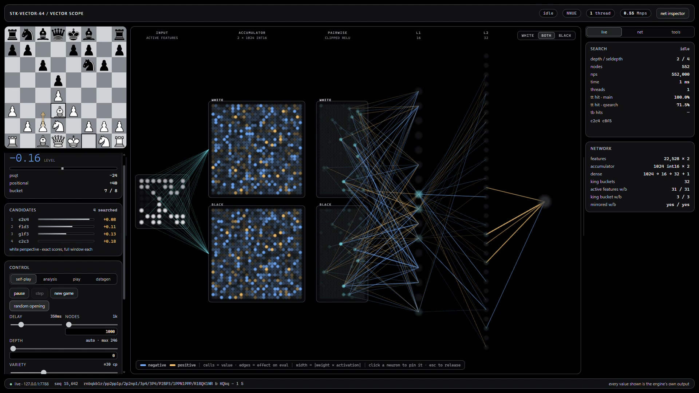
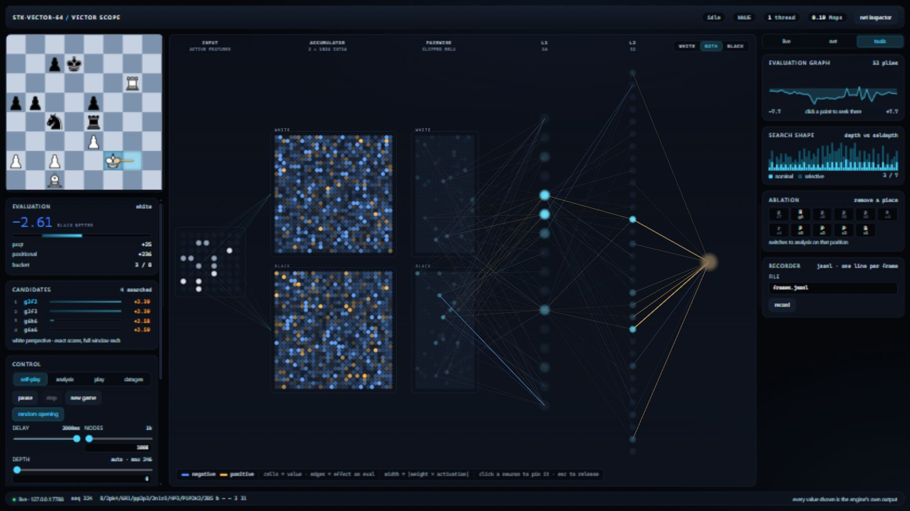
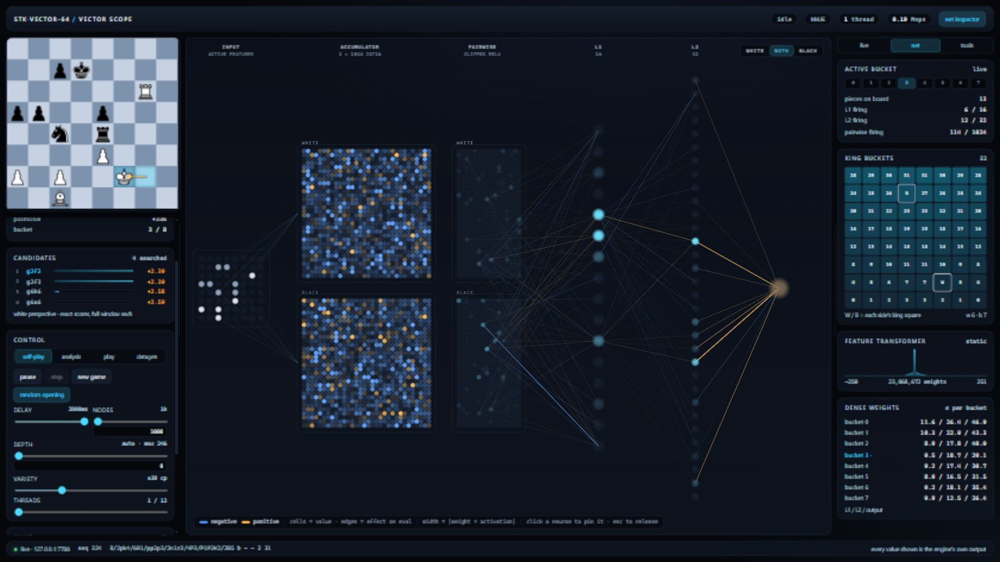

# A tour of Vector Scope

Start `ChessEngine-viz --headless` and open `http://127.0.0.1:7777`.
The [setup/reference](visualizer.md) covers paths, flags and browser builds.
These captures show the real native UI with the shipped H=1024 weights.

## Watch the network respond

[Full-resolution 1080p live recording](assets/vector-scope-live-1080p.mp4).
The clip uses a small node budget to demonstrate the display. Its NPS and moves
are not a benchmark or strength result. Weights stay fixed while activations,
selected buckets and evaluations change with the sampled position.

## Follow a position through the field

1. **Board and candidates.** The board shows game/root state. Candidate moves
   and their PVs belong to search. The live neural capture can instead follow
   a PV leaf, so compare its FEN/side to move before interpreting its score.
2. **Input features.** The small input field identifies active piece/king-context
   features. A move changes sparse features; it does not retrain the model.
3. **Accumulators.** The two colored fields contain 1024 signed integer values
   per perspective. Blue is negative and amber is positive. Brightness expresses
   value magnitude, not a probability that a move is correct.
4. **Pairwise activation and dense layers.** Pairwise clipped activations feed
   the 16-unit and 32-unit layers of the selected head. Edges show selected
   weight-times-activation effects. Their width reflects magnitude; the display
   does not draw every connection.
5. **Evaluation.** The final value combines positional output and the integrated
   PSQT side output. Engine values are mover-relative; the UI's evaluation panel
   presents a White perspective. Search score, sampled static evaluation and
   calibrated winning odds are different quantities.

Click a neuron to pin its inspection card; press Escape to release it. Choose
White, Both or Black above the field to focus the displayed perspective. The
labelled architecture is the existing [network contract](vector64-spec.md).
Click the chess board to enlarge it while play continues; press Escape or click
outside the enlarged view to return. The recording demonstrates this during
play, followed by direct neuron inspection.

## Explore without losing the context

**Self-play** generates a visible game. Set the node budget and thread count
explicitly; use delay to slow the demonstration. Opening variety chooses among
near-equal scored moves for the opening portion, while random opening changes
the starting position of later games. Neither control changes the weights.

**Analysis** accepts a FEN or PGN through the position controls. PGN parsing
happens in the UI and resulting moves are validated by the engine. The game
history and evaluation graph can seek to an earlier ply. Seeking changes mode
and position; it is not merely moving a chart cursor.

**Play** lets a human move against the engine using engine-supplied legal moves.
The selected engine color and clocks belong to that session. The native viewer
does not become a multi-user chess server when opened in several tabs.

**Tools** includes the evaluation graph, search shape, ablation and frame-summary
recording. Search shape displays nominal versus selective depth, not a complete
search tree. Ablation removes a selected non-king piece and reevaluates the
changed position; it is an intervention, not an additive explanation of the
original score. Preserve the baseline before exploring another position.

## Inspect weights and buckets

The inspector combines static transformer/dense weight statistics with live
position-dependent bucket and firing information. Eight output heads are
selected by piece count. King buckets select feature-transformer context; they
are a different kind of bucket. Reading these separately avoids mistaking a
king move for a change to the trained parameters.

An optional comparison net is evaluated on the same sampled positions. A score
difference measures two evaluations; it does not establish which net plays
better. Use [controlled matches](benchmark.md#match-runner) for strength claims.

## Recordings, datasets and current boundaries

The UI recorder writes JSONL frame summaries, not screen video and not complete
binary activation frames. Datagen writes labelled positions and separate resume
state; see [data generation](datagen.md) and [telemetry](spec/telemetry.md).
Datagen locks most controls so an analysis/ablation operation cannot silently
replace the game being recorded.

Pausing can leave the last snapshot showing the old button/status until another
publication occurs. The [known UI state boundary](limitations.md#visualizer-state-publication)
explains recovery. Initial node/delay form defaults can also differ from CLI
overrides; set them explicitly in the UI when producing a demonstration.
